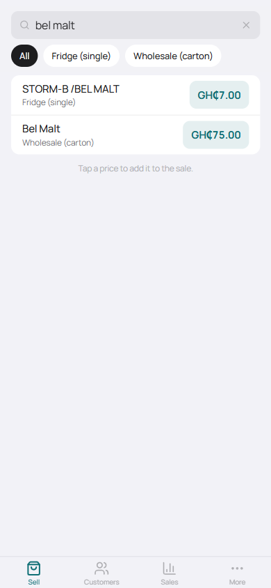
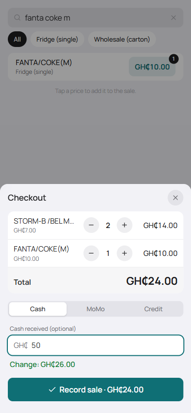
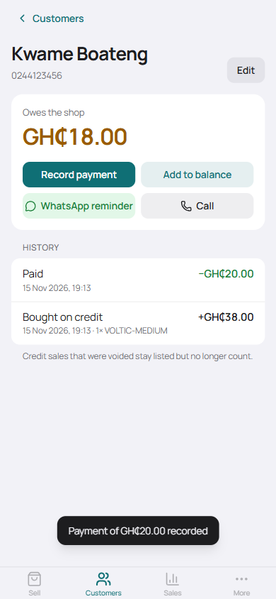
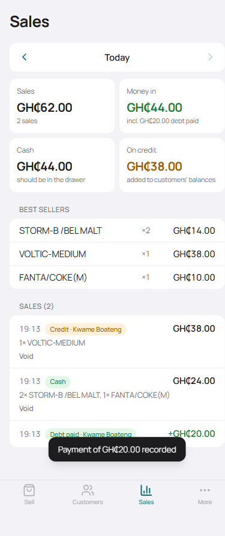

<div align="center">


# Pour

**Price lookup, sales and customer credit for a small shop. Built for the counter, and works offline.**

[](https://github.com/ohenemanaf/POS-counter/actions/workflows/ci.yml)


[](LICENSE)

</div>

| Sell | Checkout | Customer credit | Daily report |
|---|---|---|---|
|  |  |  |  |

Pour runs the counter at **DECORCH ENTERPRISE**, a drinks shop in Ghana. It merges two earlier projects:

- **Pour v1**: a price lookup for wholesale cartons and fridge bottles
- **debt_Tracker**: a Streamlit app that stored customer debts in Google Sheets

## Features

**Sell**
- Find any product fast. Search ignores case, spaces and dashes, so "voltic small" finds `VOLTIC-SMALL`. Filter by category, and use Ctrl+K on desktop to jump to the search box.
- Tap a price to add it to the sale. Each product shows every size it's sold in, for example a fridge bottle and a wholesale carton.
- **Checkout:** adjust quantities, then take **cash** (it works out the change), **MoMo**, or **credit** to a named customer.
- **Undo** a sale within a few seconds of recording it.

**Customers and credit**
- Credit sales go straight onto the customer's balance. Customers can be added during checkout.
- Record **part-payments** (cash or MoMo). The full history is kept, so nothing is deleted when a debt is cleared.
- One-tap **WhatsApp reminder** with the balance already filled in, using the Ghana number in international format, plus a Call button.
- Customers are sorted by who owes the most.

**Daily report**
- Sales, money in, cash expected in the drawer, and the amount given on credit
- Best sellers, and every sale with its time, items and how it was paid
- Debt payments collected that day
- **Void** a sale (PIN and reason required). A voided sale stays listed but stops counting, and a voided credit sale comes off the customer's balance.
- Go back through previous days.

**Shop admin** (behind a PIN)
- Edit prices and sizes, and add or remove products
- 4-digit PIN for prices, voids and restoring backups. It's stored as a hash, stays on the device, and is never included in backups.

**Keeping data safe**
- **Back up** to a file, shared to WhatsApp or Google Drive from the phone's share menu. The app reminds you when a backup is overdue.
- **Restore** a backup on another phone.
- **Export sales** to CSV for Excel or Google Sheets.
- **Import the old debt tracker:** download the Google Sheet as CSV. Names are matched to existing customers, and the original dates are kept.

## How the data works

Everything lives **on the shop's phone** in IndexedDB. There are no accounts, no server and no internet requirement. The app asks the browser to keep this data permanently (`navigator.storage.persist`), and backups cover the case where the phone is lost.

All money is stored as **whole pesewas** (integers), so totals never drift the way decimals do (0.1 + 0.2 ≠ 0.3).

## Upgrading from v1 (already on the shop's phone)

v1 kept its catalog in `localStorage` and served its page from a cache-first service worker. The upgrade is built so the shop never loses a price and never sees a blank screen:

1. **The catalog is migrated, never reset.** On first launch, v2 copies v1's products, **including the shop's own edits**, into IndexedDB. If an item had different bottle and carton prices, both are kept as separate options. The v1 data is left in place as a rollback copy.
2. **No blank screen during the switch.** After the deploy, a phone may show its cached v1 page one last time. v1's JavaScript and CSS (`public/assets/index-Dknie7dj.js` and `index-Mam0g2Ts.css`) are still deployed, so that page works. The new service worker, at the same `/sw.js` path, takes over and removes the old cache, and the next launch is v2.

This was rehearsed end to end: the real v1 build, a price edited in v1's Admin screen, then v2 deployed on the same address. The first open showed working v1, the second showed v2, and the edited prices were kept.

> Keep the two legacy files in `public/assets/` for a few months, until every phone has opened the app at least once since the upgrade.

## Getting started

```bash
npm install
npm run dev        # http://localhost:5173
npm test           # 30 tests: logic + database (fake-indexeddb) + real v1 catalog migration
npm run build      # production build + service worker in dist/
npm run preview    # serve the build to try it offline
```

## Deploying

The live site is on Vercel, and pushing to `main` redeploys it. `vercel.json` makes sure `sw.js` is never cached by the browser, so updates reach phones.

## Project structure

```
src/
├── lib/
│   ├── money.js      # pesewas, formatting, parsing typed prices
│   ├── shop.js       # cart, daily summary, balances, WhatsApp links, search (pure)
│   ├── migrate.js    # v1 catalog -> v2
│   ├── backup.js     # backup format, CSV, old debt-sheet import
│   ├── db.js         # IndexedDB: first-run migration, sales, ledger, backup/restore
│   └── hooks.js      # live queries, hash router, toasts, PIN lock
├── components/       # UI kit, forms, PIN pad
├── views/            # Sell, Customers, Sales (Today), More
├── data/             # the Decorch menu, for a fresh install
└── sw-template.js    # service worker (filled in at build time)
tests/                # Vitest; fixtures generated from v1's own code
```

## License

[MIT](LICENSE)

## Author

**Abdul Manaf Ali** · [@ohenemanaf](https://github.com/ohenemanaf)
